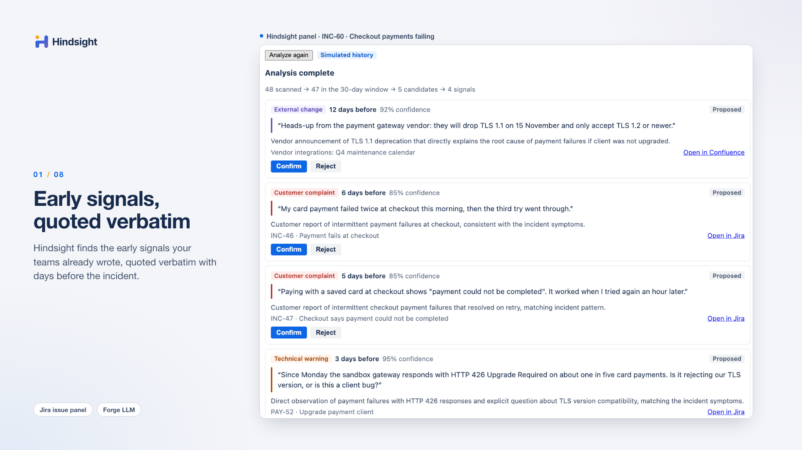
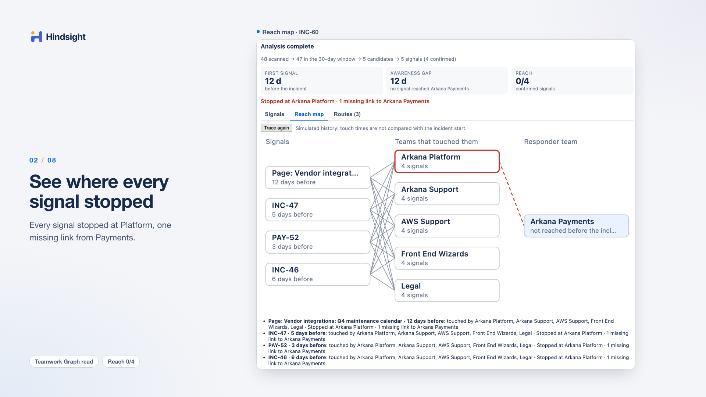
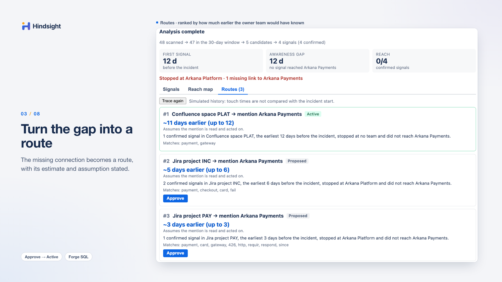
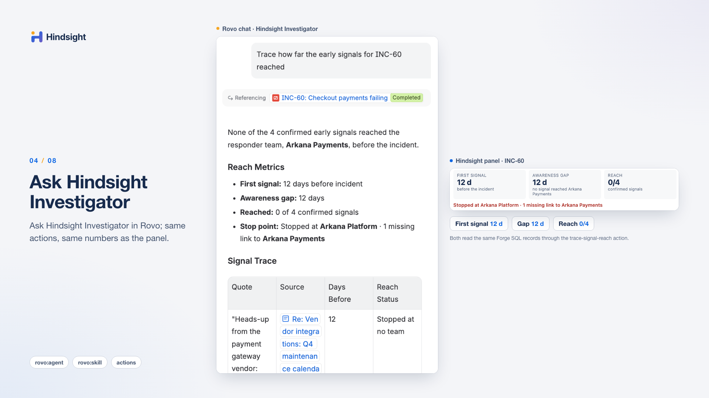
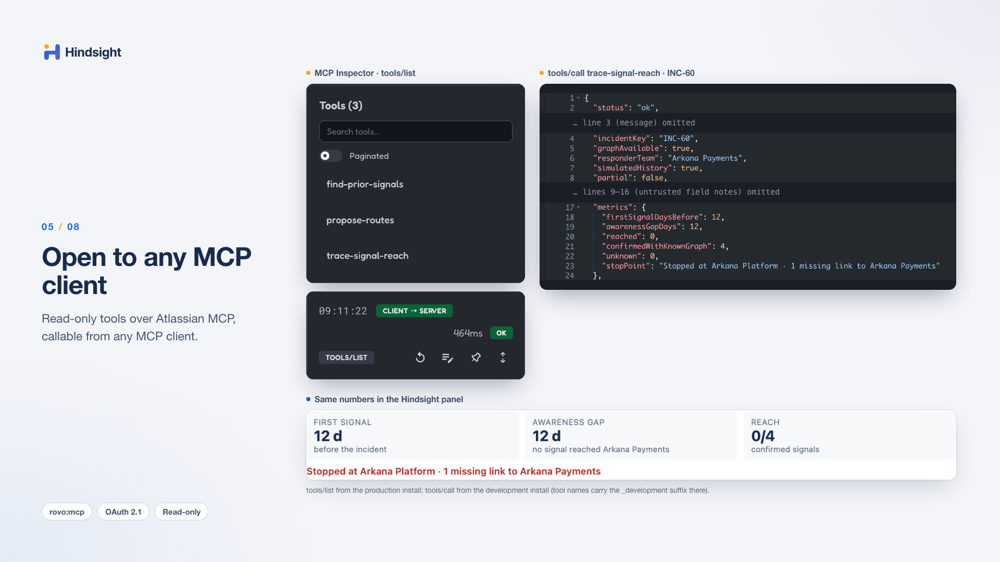
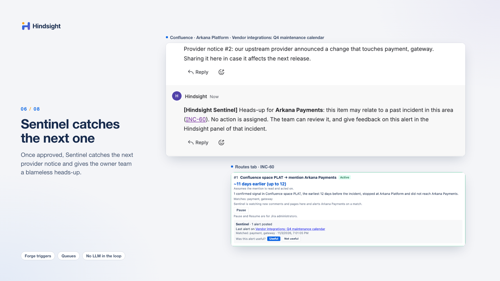
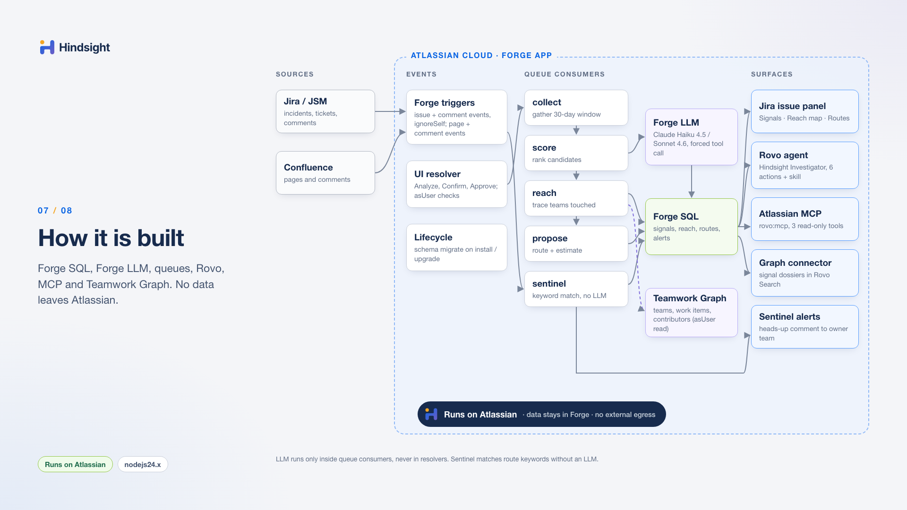
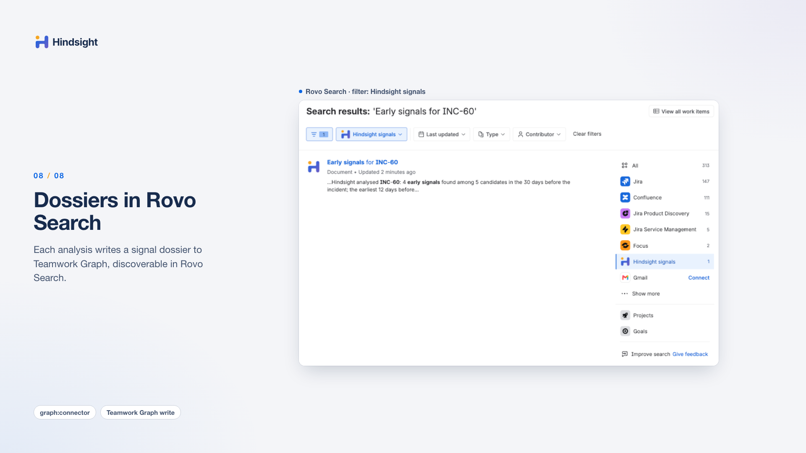

<picture>
  <source media="(prefers-color-scheme: dark)" srcset="docs/assets/hindsight-logo-wordmark-white.svg">
  
</picture>

**Your organization usually knew before the incident. Hindsight finds where that knowledge got stuck, and makes sure it reaches the right team next time.**

[](https://developer.atlassian.com/platform/forge/)
[](#data-and-privacy)
[](LICENSE)
[](https://codegeist2026.devpost.com/)

Hindsight is an Atlassian Forge app for Jira (including Jira Service Management) and Confluence. For a past incident, it looks back at the comments, tickets and pages created before the incident, finds the early signals that already pointed to the problem, and shows where they stopped travelling. Routes approved by people then watch for similar signals and alert the right team next time.

Built for Atlassian Codegeist 2026 (Apps for Software Teams). Runs on Atlassian: no external servers, no third-party AI.

**[Install](#install)** · **[Demo walkthrough](#load-demo-data)** · **[Gallery](#gallery)** · **[Architecture](#how-it-is-built)** · **[Privacy](docs/PRIVACY.md)**

## Demo video

[](https://youtu.be/aES9vJJ41c0)

▶ [Watch on YouTube](https://youtu.be/aES9vJJ41c0)

## The problem

Most incidents are preceded by signals that were already written down: an unanswered question on a story, a customer ticket closed as "cannot reproduce", a note on another team's Confluence page. Postmortems start the timeline when the alert fires, so the most important lesson gets lost: the organization knew, but the knowledge never travelled to the team that could act.

In the demo company, Arkana Commerce, checkout payments fail because the payment provider retired TLS 1.1. Hindsight scans about 50 artifacts and finds 4 signals. The first one, a provider notice on the Platform team's Confluence page, appeared **12 days** before the incident. **0 of 4** signals reached Arkana Payments, the team that owns checkout: every one stopped at Arkana Platform, one missing link away. The top proposed route would have warned Payments **~11 days earlier** (up to 12).

Hindsight answers two questions most teams never measure: how many days before the incident did the first signal appear, and which single missing connection would have shortened that time the most?

## What it does

| | Feature | What happens |
| --- | --- | --- |
| 🔎 | **Analyze → signals** | On an incident, the **Hindsight** issue panel collects work items, comments, pages and page comments from the projects and spaces mapped to the affected service (up to 30 days back), filters them deterministically, and scores the candidates with Forge LLM (Claude, hosted by Atlassian). Each signal shows its type, days before the incident, confidence and a verbatim quote that is checked against the source text; an invented quote is discarded. |
| ✅ | **Confirm** | Signals stay Proposed until a person clicks **Confirm** or **Reject** (with Undo). Nothing counts in the metrics until it is confirmed. AI output is a proposal, not a verdict. |
| 🗺️ | **Reach map** | **Trace reach** follows who touched each confirmed signal (authors, commenters, Jira watchers, Confluence page editors), maps them to teams through Teamwork Graph, and shows first signal, awareness gap, reached/confirmed, and where each signal stopped ("Stopped at Arkana Platform · 1 missing link to Arkana Payments"). |
| 🛤️ | **Routes** | Hindsight proposes one route per source (Confluence space, Jira project, component or label), ranked by an estimate of how many days earlier the team would have known, with its assumption stated. A person **Approves** a route to make it Active, and can **Pause** or **Resume** it. |
| 🚨 | **Sentinel** | An Active route watches new Jira work items and comments and new or updated Confluence pages and comments in its source. When one matches the route's keywords (deterministic, **no AI call**), Hindsight posts one neutral comment: "[Hindsight Sentinel] Heads-up for **team**", linking the past incident. It names the team, never a person; in Jira Service Management projects it is an internal comment. Alerts get **Useful / Not useful** feedback, are deduplicated, and are capped per team per week and per day. |
| 🤖 | **Rovo agent and skill** | The **Hindsight Investigator** agent and the reusable `early-signal-investigation` skill use the actions `find-prior-signals`, `confirm-signal`, `trace-signal-reach`, `propose-routes` and `create-route`, and return the same numbers as the panel. Write actions show Rovo's review form first. |
| 🔌 | **Atlassian MCP** | Three **read-only** tools (`find-prior-signals`, `trace-signal-reach`, `propose-routes`) are available to any MCP client through Atlassian's MCP endpoint once an admin enables them. Write actions are never exposed over MCP. |
| 🕸️ | **Teamwork Graph** | Hindsight reads teams and membership from Teamwork Graph and, through a Forge graph connector, writes a "signal dossier" ("Early signals for INC-…", numbers and incident key only) that appears in Rovo Search. |
| 🛡️ | **Permission-aware and blameless** | Every quote, title and link is shown only to users who can open the source artifact; others see a count. Reports talk about teams and paths, never about individuals; there are no individual metrics. |

## Gallery

<table>
  <tr>
    <td width="50%"><a href="docs/images/signals.png"></a><br><sub><b>Signals.</b> Hindsight finds the early signals your teams already wrote, quoted verbatim with days before the incident.</sub></td>
    <td width="50%"><a href="docs/images/reach-map.png"></a><br><sub><b>Reach map.</b> Every signal stopped at Platform, one missing link from Payments.</sub></td>
  </tr>
  <tr>
    <td width="50%"><a href="docs/images/routes.png"></a><br><sub><b>Routes.</b> The missing connection becomes a route, with its estimate and assumption stated.</sub></td>
    <td width="50%"><a href="docs/images/rovo-agent.png"></a><br><sub><b>Rovo agent.</b> Ask Hindsight Investigator in Rovo; same actions, same numbers as the panel.</sub></td>
  </tr>
  <tr>
    <td width="50%"><a href="docs/images/mcp-client.png"></a><br><sub><b>Atlassian MCP.</b> Read-only tools over Atlassian MCP, callable from any MCP client.</sub></td>
    <td width="50%"><a href="docs/images/sentinel-alert.png"></a><br><sub><b>Sentinel.</b> Once approved, Sentinel catches the next provider notice and gives the owner team a blameless heads-up.</sub></td>
  </tr>
  <tr>
    <td width="50%"><a href="docs/images/architecture.png"></a><br><sub><b>Architecture.</b> Forge SQL, Forge LLM, queues, Rovo, MCP and Teamwork Graph. No data leaves Atlassian.</sub></td>
    <td width="50%"><a href="docs/images/teamwork-graph-dossier.png"></a><br><sub><b>Teamwork Graph dossier.</b> Each analysis writes a signal dossier to Teamwork Graph, discoverable in Rovo Search.</sub></td>
  </tr>
</table>

## How it is built


Pipeline: **collect → filter → score → reach → propose**, each step a small, resumable Forge queue job with per-step progress in the UI. 429 responses from Jira or the LLM are retried through the queue.

| Forge module | Used for |
| --- | --- |
| `jira:issuePanel` + `jira:adminPage` (Custom UI, React + `@forge/bridge`) | Incident panel (Signals, Reach map, Routes) and the admin Setup page (service mapping, demo data) |
| `consumer` (Forge queues) | Pipeline jobs, Sentinel, schema migration and demo jobs |
| `trigger` | Sentinel: a Jira trigger (`ignoreSelf`) and a separate Confluence trigger; the handler only enqueues |
| `sql` (Forge SQL) | Events, candidates, signals, decisions, reach paths, routes, Sentinel alerts and feedback |
| `llm` (Forge LLM, `@forge/llm`) | Claude Haiku 4.5 for scoring, Claude Sonnet 4.6 as the strong model, picked at runtime; forced tool call with validated JSON; called only from queue consumers |
| `rovo:agent`, `rovo:skill`, `action` | Hindsight Investigator, `early-signal-investigation` and their actions |
| `rovo:mcp` | The three GET actions as read-only MCP tools |
| `graph:connector` (`@forge/teamwork-graph`) | Writes the signal dossier to Teamwork Graph; reads go through `requestTeamworkGraph` as the user |
| `scheduledTrigger` | Daily retention clean-up |

TypeScript strict, Vitest unit tests for the filter, quote verification, metrics and routes.

## Data and privacy

- **Runs on Atlassian.** Hindsight runs entirely on Atlassian Forge: no egress, no remote backend, no third-party services. The developer has no access to your site's data.
- **Forge SQL.** Analysis results, routes, alerts and settings are stored in Atlassian-hosted Forge SQL, separate per installation. Hindsight stores references and short excerpts (candidate excerpts of at most 2,000 characters, signal quotes of at most 300), not full copies of your content, and no names or email addresses.
- **Forge LLM.** Candidate signals are scored by Claude models hosted by Atlassian through Forge LLM. Content does not leave Atlassian. Artifact text is treated as untrusted data, never as instructions.
- **Permission checks.** Quotes, titles and links are shown only to users who can open the source artifact (checked as the user, `asUser`); MCP tools and Rovo actions apply the same checks.

Details: [Privacy Policy](docs/PRIVACY.md) · [Terms of Service](docs/TERMS.md)

## Requirements

- **Jira Cloud** (required). Jira Service Management is optional: without it, the demo creates `INC` as a software project.
- **Confluence Cloud** on the same site (optional, recommended): needed for page signals, the demo space and Confluence Sentinel alerts.
- **Rovo enabled on the site** for the Rovo agent, the skill and the Teamwork Graph connector. Without Rovo, the connector shows "Not available — Rovo is disabled on this site". The core issue panel (Load demo data, Analyze, Confirm, reach map, Routes, Sentinel) and the external MCP tools work without Rovo.
- **Organization admin** to install (Teamwork Graph scopes), to connect the Teamwork Graph connector and to enable MCP tools.
- **Jira administrator** to open the Hindsight setup page.

## Install

Installation link (Jira + Confluence): https://developer.atlassian.com/console/install/288617c9-b888-4d17-af01-241b9acfe722?signature=AYABeLcRTww9qQhK%2BaBZfVNsSIIAAAADAAdhd3Mta21zAEthcm46YXdzOmttczp1cy13ZXN0LTI6NzA5NTg3ODM1MjQzOmtleS83MDVlZDY3MC1mNTdjLTQxYjUtOWY5Yi1lM2YyZGNjMTQ2ZTcAuAECAQB4CxqLTo9l4lqXuFjNim1xJM%2Bp%2F3TVP9xHS2BrU5DRRucBtwk12%2B32MkPj4xXTOeVLHgAAAH4wfAYJKoZIhvcNAQcGoG8wbQIBADBoBgkqhkiG9w0BBwEwHgYJYIZIAWUDBAEuMBEEDG8H8c6Mrn25Vfp%2FbAIBEIA7EqCVgrb5i3A%2BFrnceDhu6GL2x8nI%2FGKgDkFFMGKnv0%2Fk6rYWG3TKP6gl4PrKSNKSdV5O0WRCF%2F8HjkYAB2F3cy1rbXMAS2Fybjphd3M6a21zOmV1LXdlc3QtMTo3MDk1ODc4MzUyNDM6a2V5LzQ2MzBjZTZiLTAwYzMtNGRlMi04NzdiLTYyN2UyMDYwZTVjYwC4AQICAHi9bVMAkme4qVQX1fQHo6ePw3H40A7cGfz7yrmSfBWMXgFabIFXUS5akYpcEorvbE4%2FAAAAfjB8BgkqhkiG9w0BBwagbzBtAgEAMGgGCSqGSIb3DQEHATAeBglghkgBZQMEAS4wEQQMcUFtx91kWJ3ZDhsvAgEQgDsQKeUIthQ%2BwLgGNHRvkyct8wyoN%2FMgwswYanj2BPJ1zZE33yHnLyUODPYyc8f2GugG4nzYvt6q%2F9Qf3QAHYXdzLWttcwBLYXJuOmF3czprbXM6dXMtZWFzdC0xOjcwOTU4NzgzNTI0MzprZXkvNmMxMjBiYTAtNGNkNS00OTg1LWI4MmUtNDBhMDQ5NTJjYzU3ALgBAgIAeDYASx0XCjkny4iLV6vz%2BKtEGSGT6kdt0QRpkn6D%2FlVEAT%2Bb4nWUytbS6wnbtJEo7N0AAAB%2BMHwGCSqGSIb3DQEHBqBvMG0CAQAwaAYJKoZIhvcNAQcBMB4GCWCGSAFlAwQBLjARBAxsR8HzOXNqFR2cfcECARCAO8Qhnsgd7uHWi%2FzbEoDkobzhPQM6485rWaBp0uWjqjHJOp80DlnZTIH%2FCb5uYSojeY7TSZ1%2FKum73XBYAgAAAAAMAAAQAAAAAAAAAAAAAAAAAHKH%2Fx8SJIi6MskrvU%2BYIFP%2F%2F%2F%2F%2FAAAAAQAAAAAAAAAAAAAAAQAAADIXZMFDu8Ntd0zNsK63pvRyLykkzEzjBtjiUP7Q6QpqVo3vOIaHuo0psPtRKcAQTGC6gqp9bQWhttRWm0oVZ59wyhI%3D&product=jira&product=confluence

Use the installation link above (the same link is listed in the Codegeist 2026 submission on Devpost). Install it on **Jira** first, then on **Confluence** on the same site (this order also avoids the MCP `-32014` error described below). An organization admin approves the requested scopes during install.

## Setup (configuration)

Open **Jira → Apps → Hindsight setup** (Jira administrators only).

1. Wait until the page shows "Database ready". The schema is created automatically after install.
2. **Service mapping:** for each service, list the Jira projects, components, labels and Confluence spaces that belong to it, and the **owner team id** (the Atlassian Teams id of the team that responds to its incidents). Hindsight only scans what is mapped here, plus the incident's own project.
3. Optional: set the weekly Sentinel alert cap per team.

Without an owner team id, the reach map shows "Graph context not available" instead of 0.

## Use Hindsight on your incidents

1. Open a past incident in a mapped project and open the **Hindsight** issue panel.
2. Click **Analyze** (once). Review each proposed signal and **Confirm** or **Reject** it; AI output is a proposal, not a verdict.
3. Click **Trace reach** to see whether the confirmed signals reached the owner team before the incident and where they stopped.
4. Open **Routes**, **Approve** the routes you want to keep watching. Sentinel then posts a team-level heads-up when a matching artifact appears; give **Useful / Not useful** feedback on alerts.
5. Optionally ask the **Hindsight Investigator** in Rovo, or call the MCP tools, for the same results.

## Load demo data

The demo is a fictional company, Arkana Commerce.

1. In **Hindsight setup**, click **Load demo data** and wait for `done · step 10/10` (about 1–2 minutes). It creates Jira project `INC` (incidents), Jira project `PAY` and Confluence space `PLAT`, about 50 work items, tickets, pages and comments, and the incident **"Checkout payments failing"**.
   - **With Jira Service Management:** `INC` is a service project and customer tickets are requests.
   - **Without Jira Service Management:** `INC` is a software project and customer tickets are work items labelled `hindsight-demo-customer`. The analysis finds the same four signals.
   - If a project key `INC` or `PAY` is still in the Trash from an earlier attempt, delete it permanently first.
2. In Atlassian Teams, create **Arkana Platform**, **Arkana Support** and **Arkana Payments**. Stay a member of Platform and Support; leave Payments (it can have no members).
3. In **Service mapping**, edit `checkout`, paste the team id of **Arkana Payments** as owner team, and save.
4. Click **Stamp demo data**. It adds a "Reviewed by" note to a demo page and makes you a watcher of a few demo work items, so the demo has human touches in Teamwork Graph.
5. Open the incident **"Checkout payments failing"** in `INC`, open the **Hindsight** panel and click **Analyze** once (about 20 seconds). Expected: about 50 artifacts scanned → 5 candidates → 4 signals (the exact scan count varies slightly by site).
6. **Confirm** all four signals, then click **Trace reach**. Expected: first signal 12 d, awareness gap 12 d, reach 0/4, each signal "Stopped at Arkana Platform · 1 missing link to Arkana Payments".
7. Open **Routes**: Confluence space PLAT (~11 days earlier, up to 12), Jira project INC (~5), Jira project PAY (~3). Click **Approve** on the PLAT route; it becomes Active.
8. Back in setup, click **Post a new provider notice** (needs the Active PLAT route). The Sentinel alert appears within a few minutes, once Confluence search has indexed the notice. Open the Platform page in Confluence to see "[Hindsight Sentinel] Heads-up for Arkana Payments"; the **Routes** tab shows "1 alert posted".

Notes: don't click **Analyze again** after confirming, because AI scoring can surface an additional, weaker signal. If you join Arkana Payments and touch the demo artifacts, reach numbers change. **Reset to showcase** clears the demo analysis; **Remove demo data** deletes the work items and pages the app created (projects and space stay).

## Connect the Teamwork Graph connector

Requires an organization admin and Rovo enabled on the site.

1. In `admin.atlassian.com`, open your organization → **Connectors** → **All connectors** → **Add connector**.
2. Choose the category **Other**, select **Hindsight signals**, enter a name and click **Connect**.
3. The setup page shows "Connector: connected". After the next analysis, the dossier "Early signals for <incident key>" appears in Rovo Search (full search page, filter "All apps").

Dossiers are visible to everyone in the organization only for the demo incident, or for all incidents if the setting `dossier_all_incidents` is true (default false). Without a connector, Hindsight still reads Teamwork Graph and writes nothing to it.

## Enable MCP tools

Requires an organization admin.

1. Install Hindsight on Jira and Confluence on the same site.
2. In `admin.atlassian.com`, go to **Site settings → Connected apps → Hindsight → Details** and click **Enable tools** ("Expose tools to MCP-compatible apps" = Enabled).
3. Add the server to your MCP client. Endpoint:

   ```
   https://mcp.atlassian.com/forge/288617c9-b888-4d17-af01-241b9acfe722
   ```

   For Claude Code:

   ```sh
   claude mcp add --transport http hindsight https://mcp.atlassian.com/forge/288617c9-b888-4d17-af01-241b9acfe722
   ```

   Then run `/mcp` and complete the OAuth login in the browser, choosing your site. Other clients: streamable HTTP transport, same URL.
4. `tools/list` returns `find-prior-signals`, `trace-signal-reach` and `propose-routes`. Call `find-prior-signals` with an incident key, for example the demo incident after Analyze. Tools return only what the signed-in user may see.

If `tools/list` returns error **-32014** ("not allowed to expose its tools over the external MCP endpoint on this site"), tools were enabled while the app was connected to both Jira and Confluence. Workaround: in **Connected apps → Hindsight → Connections**, disconnect Confluence; in **Details**, click **Disable tools** and then **Enable tools**; run `tools/list` again; then reconnect Confluence. Alternatively, install on Jira first, enable tools, then install on Confluence.

Tool names carry the suffix `_development` (for example `find-prior-signals_development`) only in the Forge development environment; the installed production app uses the names above.

## Use the Rovo agent

Requires Rovo enabled on the site. Open Rovo from an incident, choose **Hindsight Investigator**, and ask, for example:

- *"Did we have early signals before INC-15?"*
- *"Trace how far the early signals for INC-15 reached."*
- *"Which route would have warned us earliest?"*

The agent returns the same numbers as the panel. Confirming a signal or approving a route from chat shows Rovo's "Please review" form before anything is written.

## Development

Requires Node.js 22 or newer (`engines: >=22`; the Forge runtime is `nodejs24.x`) and the [Forge CLI](https://developer.atlassian.com/platform/forge/getting-started/).

```sh
npm install
npm test           # Vitest unit tests
npm run typecheck  # tsc for the backend and the Custom UI
npm run build      # typecheck + build the Custom UI views into static/<view>/build
npm run lint       # forge lint (needs a registered app id in manifest.yml)
npm run deploy     # build the UI and forge deploy
```

Layout: `src/core/` (pipeline, metrics, routes, migrations), `src/llm/`, `src/adapters/` (Jira, Confluence, Teamwork Graph, Forge SQL), `src/surfaces/` (UI resolver, background jobs, Rovo actions), `ui/src/` (Custom UI), `prompts/`, `test/`.

## Marketplace

A separate listing app, "Hindsight Listing" (Paid via Atlassian, a different Forge app ID built from the same source), has been **submitted for Marketplace review**. It is not published yet. The installation link above stays free and unchanged.

## Documentation

- [Privacy Policy](docs/PRIVACY.md)
- [Terms of Service](docs/TERMS.md)
- [Security Policy](SECURITY.md)
- [Changelog](CHANGELOG.md)
- [License (MIT)](LICENSE)

## Support

Hindsight is provided by Bayu Trisnapati.

- Support portal: https://bayutrisnapati.atlassian.net/servicedesk/customer/portals
- Email: bayutrisnapati@gmail.com
- Security: report vulnerabilities privately as described in the [Security Policy](SECURITY.md)

## License

[MIT](LICENSE)
